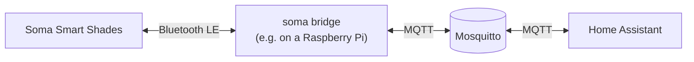
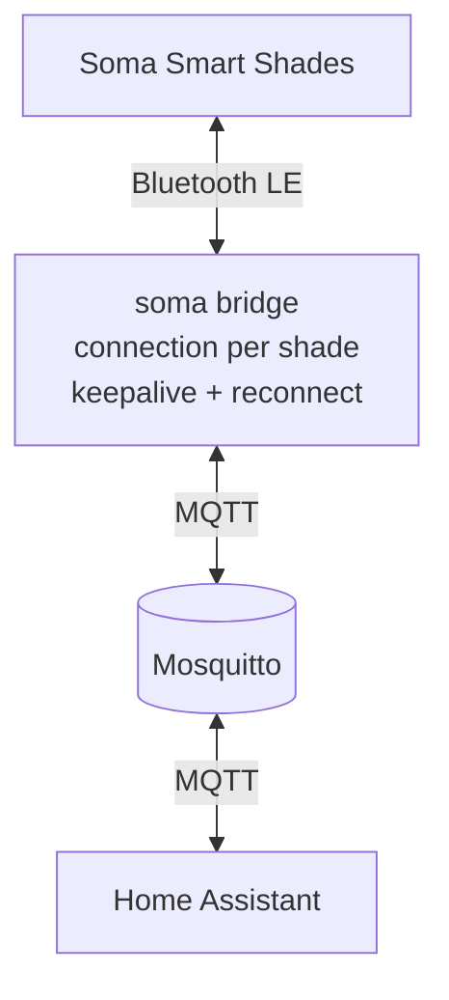

# soma-shades

[](https://github.com/vanderkley/soma-shades/actions/workflows/ci.yml)
[](https://pypi.org/project/soma-shades/)
[](https://pypi.org/project/soma-shades/)
[](LICENSE)

Control [Soma Smart Shades](https://www.somasmarthome.com/) over Bluetooth LE, without the SOMA Connect hub, and
add them to Home Assistant through MQTT.

- **`soma` command line tool**: discover the shades, move them, read the position and battery level.
- **MQTT bridge**: the shades appear as covers in Home Assistant, with live position updates.
- **Reliable connections**: keepalive, automatic reconnects, and no unavailable flapping on short connection drops.
- **Runs anywhere near the shades**: Docker image, or a systemd service on a Raspberry Pi.

> This project is not affiliated with Soma. Only the Smart Shades 2 are supported, see
> [Supported devices](#supported-devices).



## Contents
- [Supported devices](#supported-devices)
- [Installation](#installation)
- [Quick start](#quick-start)
- [Home Assistant](#home-assistant)
- [Running the bridge as a service](#running-the-bridge-as-a-service)
- [Command line reference](#command-line-reference)
- [How the bridge works](#how-the-bridge-works)
- [Troubleshooting](#troubleshooting)
- [Python API](#python-api)
- [Development](#development)

## Supported devices

| Device              | Protocol | Supported                      |
|---------------------|----------|--------------------------------|
| SOMA Smart Shades 2 | V2       | yes                            |
| SOMA Smart Shades 3 | V3       | no, planned for a next version |

The Smart Shades 3 use a different Bluetooth protocol, see the
[protocol documentation](https://github.com/rzuppur/smart-shades-documentation). `soma discover` recognizes them and
logs a warning instead of adding them.

The [Soma integration](https://www.home-assistant.io/integrations/soma/) of Home Assistant needs the SOMA Connect hub.
This project connects to the shades directly, without the hub.

## Installation
Requirements:
- Python 3.14 or newer.
- A Bluetooth LE adapter within range of the shades: Linux with BlueZ (e.g. a Raspberry Pi), or macOS.
- For Home Assistant: an MQTT broker, e.g. Mosquitto.

With [uv](https://docs.astral.sh/uv/), which also installs Python 3.14 when needed:
```bash
uv tool install soma-shades
```

Or with pip:
```bash
pip install soma-shades
```

## Quick start
1. **Discover the shades.** They are stored in a cache file, with the name from the Soma app in snake case:
   ```bash
   $ soma discover
   living_room          AA:BB:CC:DD:EE:01
   kitchen_window       AA:BB:CC:DD:EE:02
   ```

2. **Control a shade**, position 0 is open and 100 is closed:
   ```bash
   soma control living_room down
   soma control living_room set_position 50
   soma control living_room position
   ```

3. **Start the bridge** to Home Assistant, with the address of your MQTT broker:
   ```bash
   soma bridge --broker 192.168.1.10
   ```
   Stop it with Ctrl-C. To keep it running, see [Running the bridge as a service](#running-the-bridge-as-a-service).

## Home Assistant
1. Install an MQTT broker, depending on your Home Assistant installation:
   - **Home Assistant OS or Supervised**: the
     [Mosquitto broker add-on](https://github.com/home-assistant/addons/blob/master/mosquitto/DOCS.md), in Settings →
     Add-ons.
   - **Home Assistant Container** (Docker): there are no add-ons, run Mosquitto in a separate container, e.g. with the
     [Docker Compose file](#docker-compose) of this project.
   - Or install Mosquitto [on Linux](#mosquitto-on-linux).
2. Add the [MQTT integration](https://www.home-assistant.io/integrations/mqtt/) in Home Assistant, with the address of
   the broker.
3. Start the bridge. Every shade appears as a device with a cover entity, through
   [MQTT discovery](https://www.home-assistant.io/integrations/cover.mqtt/). On the first connection, the bridge reads
   the device information of a shade and the shade beeps once.

**New shades** are found when the bridge starts. To scan while the bridge runs, publish the scan duration in seconds
to the discover topic:
```bash
mosquitto_pub -h <broker> -t homeassistant/cover/discover -m 20
```

**To remove a shade**, remove it from the cache file and remove its retained discovery message, otherwise Home
Assistant keeps the cover:
```bash
mosquitto_pub -h <broker> -r -n -t homeassistant/cover/smartshade/<shade>/config
```

<details>
<summary>MQTT topics</summary>

| Topic                                                  | Direction | Payload                             |
|--------------------------------------------------------|-----------|-------------------------------------|
| `homeassistant/cover/smartshade/<shade>/config`        | publish   | discovery message                   |
| `homeassistant/cover/smartshade/<shade>/availability`  | publish   | `online`, `offline`                 |
| `homeassistant/cover/smartshade/<shade>/state`         | publish   | `open`, `closed`, `opening`, ...    |
| `homeassistant/cover/smartshade/<shade>/position`      | publish   | `0` (open) to `100` (closed)        |
| `homeassistant/cover/smartshade/bridge/availability`   | publish   | `online`, `offline` (last will)     |
| `homeassistant/cover/smartshade/<shade>/set`           | subscribe | `open`, `close`, `stop`             |
| `homeassistant/cover/smartshade/<shade>/set_position`  | subscribe | `0` to `100`                        |
| `homeassistant/cover/discover`                         | subscribe | scan duration in seconds (max 30)   |
| `homeassistant/status`                                 | subscribe | `online` republishes all messages   |

All published messages are retained.
</details>

## Running the bridge as a service
The bridge needs a Bluetooth adapter within range of the shades. The broker and Home Assistant can run anywhere on
the network. On Linux, first [check the Bluetooth access](#bluetooth-on-linux).

### Docker Compose
The [`docker-compose.yml`](docker-compose.yml) runs the Mosquitto broker and the bridge, e.g. next to a Home Assistant
container. The bridge container uses the Bluetooth of the host through D-Bus, so the host must be Linux with BlueZ.
Docker Desktop on macOS has no Bluetooth.

```bash
curl -LO https://raw.githubusercontent.com/vanderkley/soma-shades/main/docker-compose.yml
mkdir -p deploy/mosquitto
curl -Lo deploy/mosquitto/mosquitto.conf \
    https://raw.githubusercontent.com/vanderkley/soma-shades/main/deploy/mosquitto/mosquitto.conf

docker compose run --rm soma-bridge discover     # check the Bluetooth access and find the shades
docker compose up -d
docker compose logs -f soma-bridge
```
Configure the MQTT integration of Home Assistant with the broker at `<docker host>:1883`. When the Docker host is not
within Bluetooth range of the shades, run only the broker in Docker, and the bridge on a Raspberry Pi near the shades.

### Raspberry Pi with systemd
Install Bluetooth and soma-shades:
```bash
sudo apt-get install bluetooth pi-bluetooth
sudo usermod -aG bluetooth $USER
curl -LsSf https://astral.sh/uv/install.sh | sh
uv tool install soma-shades
```

Install the [systemd unit](deploy/systemd/soma-bridge.service). It runs `soma bridge` as user `pi`, connects to the
broker on `localhost`, and stores the shades cache in `/var/lib/soma-shades`:
```bash
sudo curl -Lo /etc/systemd/system/soma-bridge.service \
    https://raw.githubusercontent.com/vanderkley/soma-shades/main/deploy/systemd/soma-bridge.service
sudo systemctl daemon-reload
sudo systemctl enable --now soma-bridge.service
journalctl -u soma-bridge.service -f
```

To use another user or broker, override the unit with `sudo systemctl edit soma-bridge.service`:
```ini
[Service]
User=myuser
Group=myuser
ExecStart=
ExecStart=/home/myuser/.local/bin/soma bridge --cache-file ${STATE_DIRECTORY}/shades.json
Environment=SOMA_BROKER=192.168.1.10
```

### Mosquitto on Linux
Without Docker, install Mosquitto on the Raspberry Pi or another Linux host:
```bash
sudo apt-get install mosquitto mosquitto-clients
sudo tee /etc/mosquitto/conf.d/soma-shades.conf <<EOF
listener 1883 0.0.0.0
allow_anonymous true
EOF
sudo systemctl enable --now mosquitto
sudo systemctl restart mosquitto
```
`allow_anonymous true` lets every host on the network publish and subscribe. Only expose port 1883 on your local
network, or configure a password file and start the bridge with `--username` and `--password`.

## Command line reference

| Command                              | Description                                                            |
|--------------------------------------|------------------------------------------------------------------------|
| `soma discover`                      | Scan for shades and add them to the cache                              |
| `soma control SHADE ACTION [VALUE]`  | Run an action on a shade, see below                                    |
| `soma bridge`                        | Bridge the shades to Home Assistant through MQTT                       |
| `soma probe-sounds SHADE`            | Play the sound codes one by one, to find sounds other than the beep    |

Actions of `soma control`:
- Move: `up`, `down`, `stop`, `set_position VALUE` (0 is open, 100 is closed)
- Read: `position`, `battery`, `solar_panel`, `motor_speed`, `info`
- Other: `set_motor_speed VALUE` (0 to 100), `beep`

Run `soma COMMAND --help` for all options, and `soma -v COMMAND` for debug logging. The options can also be set with
environment variables:

| Variable          | Option                       | Default                                                 |
|-------------------|------------------------------|---------------------------------------------------------|
| `SOMA_CACHE_FILE` | `--cache-file`               | `~/.local/share/soma-shades/shades.json` on Linux       |
| `SOMA_BROKER`     | `--broker`                   | `localhost`                                             |
| `SOMA_PORT`       | `--port`                     | `1883`                                                  |
| `SOMA_USERNAME`   | `--username`                 |                                                         |
| `SOMA_PASSWORD`   | `--password`                 |                                                         |
| `SOMA_DISCOVER`   | `--discover / --no-discover` | `true`, scan for new shades when the bridge starts      |

## How the bridge works



- **A connection task per shade** keeps the Bluetooth connection open, and reconnects with an exponential backoff
  (1 second up to 5 minutes) when the connection is lost.
- **Keepalive**: the shades drop a connection after 3 minutes without requests, so the bridge reads the battery level
  every 2 minutes. This costs the shade less battery than reconnecting.
- **No flapping**: a shade is only reported unavailable when it cannot be reconnected within 2 minutes.
- **Last will**: the bridge has its own availability topic, all covers become unavailable when the bridge stops or
  loses its connection to the broker.
- **Retained messages**: Home Assistant gets the covers and their state also when it starts after the bridge.
- **One connection per shade**: a shade accepts a single Bluetooth connection, so stop the bridge before using
  `soma control` or the Soma app.

## Troubleshooting

### Bluetooth on Linux
```bash
ls -l /run/dbus/system_bus_socket     # srw-rw-rw- ... the D-Bus socket exists
systemctl status bluetooth            # active (running)
busctl --system tree org.bluez        # lists /org/bluez/hci0, the Bluetooth adapter
bluetoothctl show                     # Powered: yes
```

| Error                             | Cause                                                                                |
|-----------------------------------|--------------------------------------------------------------------------------------|
| `FileNotFoundError`               | no D-Bus socket; in Docker, `/run/dbus` is not mounted                               |
| `AccessDenied`, `PermissionError` | D-Bus or AppArmor denies the access to BlueZ, or the user is not in `bluetooth`      |
| `No Bluetooth adapters found`     | `bluetoothd` runs without an adapter, check `bluetoothctl show` and `rfkill list`    |

When the Home Assistant Bluetooth integration uses the same adapter, both compete for its connections. Use a separate
adapter for Home Assistant, or disable its Bluetooth integration.

### Shades
- **A shade stays unavailable**: run `soma -v bridge` and look for the `Connection attempt` and `Cannot connect`
  lines. Check that the shade is within range, e.g. with `soma control <shade> battery` while the bridge is stopped.
- **Connection drops**: they are logged as `Disconnected from ...` with the connection duration. Short drops are
  reconnected without Home Assistant noticing.

## Python API
```python
import asyncio

from soma_shades import ShadeFleet


async def main() -> None:
    fleet = ShadeFleet()  # the shades from the cache
    if not fleet.shades:
        await fleet.discover(scan_for=20)

    shade = fleet.get("living_room")
    await shade.connect(timeout=15)
    try:
        print(await shade.get_position(), await shade.get_battery_level())
        await shade.set_position(50)
    finally:
        await shade.disconnect()


asyncio.run(main())
```

## Development
```bash
git clone https://github.com/vanderkley/soma-shades.git
cd soma-shades
uv venv --python 3.14 && source .venv/bin/activate
uv pip install -e ".[dev]"
pre-commit install
```

| Check      | Command                                                     |
|------------|-------------------------------------------------------------|
| Tests      | `pytest` (the end-to-end tests need `mosquitto` installed)  |
| Lint       | `ruff check . && ruff format --check .`                     |
| Type check | `mypy`                                                      |

To release, update the version in `pyproject.toml` and the [changelog](https://github.com/vanderkley/soma-shades/blob/main/CHANGELOG.md), and push a tag like `v1.0.0`.
The release workflow publishes the package to PyPI and the Docker image to `ghcr.io`.

## Credits
- [rzuppur/smart-shades-documentation](https://github.com/rzuppur/smart-shades-documentation) for the protocol
  documentation.
- [andersonshatch/soma-ctrl](https://github.com/andersonshatch/soma-ctrl) for the original Node.js implementation.

## License
[MIT](LICENSE)
