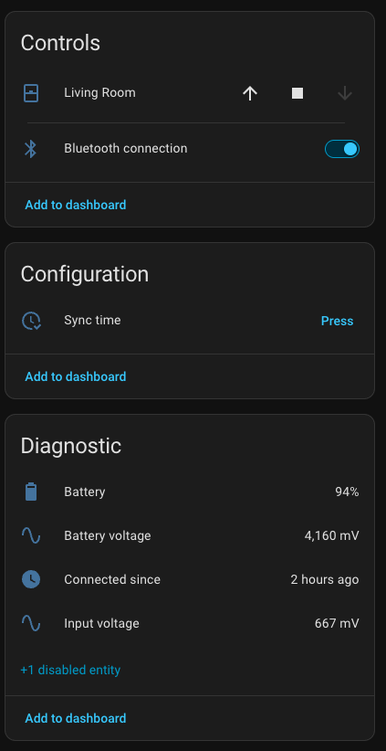

# soma-shades

[](https://github.com/vanderkley/soma-shades/actions/workflows/ci.yml)
[](https://pypi.org/project/soma-shades/)
[](https://pypi.org/project/soma-shades/)
[](https://github.com/vanderkley/soma-shades/blob/main/LICENSE)

Control [Soma Smart Shades](https://www.somasmarthome.com/) over Bluetooth LE, without the SOMA Connect hub: a Python
library, a command line tool, and an MQTT bridge to Home Assistant.

The **SOMA Smart Shades 2** and the **SOMA Tilt 2** are supported, they use the same protocol. The MQTT bridge and the
command line tool show a Tilt as a shade with a position: 0 is closed upwards, 50 is open and 100 is closed downwards.
The Smart Shades 3 use a [different protocol](https://github.com/rzuppur/smart-shades-documentation), they work with
[Zigbee2MQTT](https://www.zigbee2mqtt.io/). This project is not affiliated with Soma.

## What do you need?

| You want to                                                  | Use                                                                                                                                                                       |
|--------------------------------------------------------------|---------------------------------------------------------------------------------------------------------------------------------------------------------------------------|
| Use the shades in Home Assistant, and it is in range of them | The [Home Assistant integration](https://github.com/vanderkley/soma-shades-ha)                                                                                            |
| Use the shades in Home Assistant, but it is out of range     | The [Home Assistant integration](https://github.com/vanderkley/soma-shades-ha) with Bluetooth proxies, or the [MQTT bridge](https://github.com/vanderkley/soma-shades#mqtt-bridge) on a device close to the shades |
| Control the shades from a terminal or a script               | The [command line tool](https://github.com/vanderkley/soma-shades#command-line)                                                                                           |
| Build your own application                                   | The [Python library](https://github.com/vanderkley/soma-shades#python-library)                                                                                            |

The integration is the simplest: it needs no broker and no separate device.

## MQTT bridge
The bridge runs on a device close to the shades, and connects them to Home Assistant over your network.

```
┌──────────────┐               ┌──────────────────────┐          ┌───────────┐          ┌────────────────┐
│ Soma Smart   │ Bluetooth LE  │ Soma Bridge          │   MQTT   │ Mosquitto │   MQTT   │ Home Assistant │
│ Shades       │◄─────────────►│ connection per shade │◄────────►│ broker    │◄────────►│                │
│              │               │ keepalive, reconnect │          │           │          │                │
└──────────────┘               └──────────────────────┘          └───────────┘          └────────────────┘
```

Requirements: a Linux device with a Bluetooth LE adapter within range of the shades, and an MQTT broker.

### Docker Compose
The [`docker-compose.yml`](https://github.com/vanderkley/soma-shades/blob/main/docker-compose.yml) runs Mosquitto
and the bridge, which uses the Bluetooth of the host through D-Bus:
```bash
curl -LO https://raw.githubusercontent.com/vanderkley/soma-shades/main/docker-compose.yml
mkdir -p deploy/mosquitto
curl -Lo deploy/mosquitto/mosquitto.conf \
    https://raw.githubusercontent.com/vanderkley/soma-shades/main/deploy/mosquitto/mosquitto.conf
docker compose up -d
docker compose logs -f soma-bridge
```

### Raspberry Pi with systemd
The [systemd unit](https://github.com/vanderkley/soma-shades/blob/main/deploy/systemd/soma-bridge@.service) runs the
bridge as your user:
```bash
sudo apt-get install bluetooth pi-bluetooth pipx
sudo usermod -aG bluetooth $USER
pipx install 'soma-shades[bridge]'

sudo curl -Lo /etc/systemd/system/soma-bridge@.service \
    https://raw.githubusercontent.com/vanderkley/soma-shades/main/deploy/systemd/soma-bridge@.service
sudo systemctl daemon-reload
sudo systemctl enable --now soma-bridge@$USER
journalctl -u soma-bridge@$USER -f
```
Set the broker with `Environment=SOMA_BROKER=...` in `sudo systemctl edit soma-bridge@$USER`.

### Home Assistant
Start with the [Home Assistant integration](https://github.com/vanderkley/soma-shades-ha), it needs no broker and no
bridge. Is Home Assistant out of range of the shades? Add Bluetooth proxies close to them, the integration connects
through them. Or connect the bridge:

1. Install an MQTT broker: the Docker Compose file above includes one, on Home Assistant OS use the
   [Mosquitto add-on](https://github.com/home-assistant/addons/blob/master/mosquitto/DOCS.md).
2. Add the [MQTT integration](https://www.home-assistant.io/integrations/mqtt/) with the address of the broker.
3. Start the bridge. Every shade appears as a device through MQTT discovery, and beeps once on its first connection.



- *Sync time* sets the clock of the shade, for the schedules of the Soma app.
- *Bluetooth connection* leaves the shade free for the Soma app, also after a restart. Meanwhile it is unavailable in
  Home Assistant.
- New shades are found when the bridge starts, or with
  `mosquitto_pub -h <broker> -t homeassistant/cover/discover -m 20`.
- To remove a shade, remove it from the cache file and delete the device in Home Assistant.

<details>
<summary>MQTT topics</summary>

| Topic                                                                 | Direction | Payload                           |
|-----------------------------------------------------------------------|-----------|-----------------------------------|
| `homeassistant/cover/smartshade/<shade>/config`                       | publish   | discovery message                 |
| `homeassistant/cover/smartshade/<shade>/availability`                 | publish   | `online`, `offline`               |
| `homeassistant/cover/smartshade/<shade>/state`                        | publish   | `open`, `closed`, `opening`, ...  |
| `homeassistant/cover/smartshade/<shade>/position`                     | publish   | `0` (open) to `100` (closed)      |
| `homeassistant/cover/smartshade/<shade>/battery`                      | publish   | battery level, `0` to `100`       |
| `homeassistant/cover/smartshade/<shade>/battery_voltage`              | publish   | battery voltage in mV             |
| `homeassistant/cover/smartshade/<shade>/input_voltage`                | publish   | charging input voltage in mV      |
| `homeassistant/cover/smartshade/<shade>/charging_current`             | publish   | charging current, probably in mA  |
| `homeassistant/cover/smartshade/<shade>/connected_since`              | publish   | start of the connection           |
| `homeassistant/cover/smartshade/<shade>/bluetooth_connection`         | publish   | `ON`, `OFF`                       |
| `homeassistant/switch/smartshade/<shade>_bluetooth_connection/config` | publish   | discovery message of the switch   |
| `homeassistant/sensor/smartshade/<shade>_<sensor>/config`             | publish   | discovery messages of the sensors |
| `homeassistant/button/smartshade/<shade>_sync_time/config`            | publish   | discovery message of the button   |
| `homeassistant/cover/smartshade/bridge/availability`                  | publish   | `online`, `offline` (last will)   |
| `homeassistant/cover/smartshade/<shade>/set`                          | subscribe | `open`, `close`, `stop`           |
| `homeassistant/cover/smartshade/<shade>/set_position`                 | subscribe | `0` to `100`                      |
| `homeassistant/cover/smartshade/<shade>/sync_time`                    | subscribe | any payload sets the clock        |
| `homeassistant/cover/smartshade/<shade>/bluetooth_connection_set`     | subscribe | `ON`, `OFF`                       |
| `homeassistant/cover/discover`                                        | subscribe | scan duration in seconds (max 30) |
| `homeassistant/status`                                                | subscribe | `online` republishes all messages |

All published messages are retained, so Home Assistant also gets the covers when it starts after the bridge.
</details>

## Command line
```bash
pip install 'soma-shades[bridge]'

soma discover                               # finds the shades
soma control living_room down
soma control living_room set_position 50    # 0 is open, 100 is closed
soma control living_room beep               # probe sound
```
A shade accepts a single Bluetooth connection: first close the Soma app, and stop the bridge or the Home Assistant
integration.

Actions of `soma control`:
- Move: `up`, `down`, `stop`, `set_position VALUE` (0 is open, 100 is closed)
- Read: `position`, `battery`, `battery_voltage`, `charging`, `motor_speed`, `info`
- Other: `set_motor_speed VALUE` (0 to 100), `sync_time`, `beep`

The other commands are `soma bridge` and `soma probe-sounds SHADE`. Run `soma COMMAND --help` for the options and
`soma -v COMMAND` for debug logging. The options can also be set with the environment variables `SOMA_CACHE_FILE`,
`SOMA_BROKER`, `SOMA_PORT`, `SOMA_USERNAME`, `SOMA_PASSWORD` and `SOMA_DISCOVER`.

## Python library
```bash
pip install soma-shades
```
Use `ShadeClient` for a single shade, `ShadeFleet` to discover shades, and `ShadeConnection` to keep a connection open.

<details>
<summary>Example: read the state of a shade and move it</summary>

```python
import asyncio

from soma_shades import ShadeFleet


async def main() -> None:
    fleet = ShadeFleet()  # the shades from the cache
    if not fleet.shades:
        await fleet.discover(scan_for=20)

    shade = fleet.get("living_room")
    await shade.connect(timeout=15)
    try:
        print(await shade.get_position(), await shade.get_battery_level())
        await shade.set_position(50)
    finally:
        await shade.disconnect()


asyncio.run(main())
```
</details>

## Bluetooth adapter
A connection to every shade stays open, so the adapter has to hold several connections at the same time. Use an adapter
from the [list of Home Assistant](https://www.home-assistant.io/integrations/bluetooth/#known-working-high-performance-adapters),
e.g. a branded CSR8510A10 or a Realtek RTL8761BU like the ASUS USB-BT500. Avoid an Actions ATS2851 chip (USB ID
`10d7:b012`), often sold as "Bluetooth 5.3", and unbranded CSR clones (`0a12:0001`). On Linux, check the chip with
`lsusb` and `sudo btmgmt info`.

**Tip:** do connections still drop with `Unacceptable Connection Parameters (0x3b)`? A shade asks for other connection
parameters after connecting, and drops the connection after 105 seconds when the adapter cannot provide them. Let
BlueZ use these parameters right away: add them to `/etc/bluetooth/main.conf`, and run
`sudo systemctl restart bluetooth`.
<details>
<summary>BlueZ settings for <code>/etc/bluetooth/main.conf</code></summary>

```ini
[LE]
# shortest time between two connection events, in units of 1.25 ms: 16 × 1.25 = 20 ms (default 24: 30 ms)
# the shades ask for 16 (20 ms)
MinConnectionInterval=16
# longest time between two connection events, in units of 1.25 ms: 32 × 1.25 = 40 ms (default 40: 50 ms)
# the shades ask for 32 (40 ms), with a longer interval they ask for an update and drop the connection when it fails
MaxConnectionInterval=32
# connection events the shade may skip to save power: none (default 0)
# the shades ask for 0, they answer every event, so a command arrives within one interval
ConnectionLatency=0
# time without an answer before the connection is lost, in units of 10 ms: 80 × 10 = 800 ms (default 42: 420 ms)
# the shades ask for 80 (800 ms), a weak connection then survives short interference
ConnectionSupervisionTimeout=80
```
</details>

## Troubleshooting
Check the Bluetooth access on Linux:
```bash
ls -l /run/dbus/system_bus_socket     # the D-Bus socket exists
systemctl status bluetooth            # active (running)
bluetoothctl show                     # Powered: yes
```

| Error                             | Cause                                                                                |
|-----------------------------------|--------------------------------------------------------------------------------------|
| `FileNotFoundError`               | no D-Bus socket; in Docker, `/run/dbus` is not mounted                               |
| `AccessDenied`, `PermissionError` | D-Bus or AppArmor denies the access to BlueZ, or the user is not in `bluetooth`      |
| `No Bluetooth adapters found`     | `bluetoothd` runs without an adapter, check `bluetoothctl show` and `rfkill list`    |

- **A shade stays unavailable**: run `soma -v bridge` and look for `Cannot connect`. Check the range with
  `soma control <shade> battery` while the bridge is stopped.
- **The bridge and Home Assistant on the same device** compete for the same adapter. Give the bridge a separate adapter,
  or disable the Bluetooth integration of Home Assistant.
- **All shades fail with `TimeoutError` or `device disappeared`**: BlueZ can get stuck after many failed
  connections. Restart it with `sudo systemctl restart bluetooth`.
- **Connections drop at a fixed interval**: show the reason with `sudo btmon | grep -A4 "Disconnect Complete"`.
  `Unacceptable Connection Parameters (0x3b)` every 105 seconds is the adapter, see
  [Bluetooth adapter](https://github.com/vanderkley/soma-shades#bluetooth-adapter). `Connection Timeout (0x08)` is
  the range.

## Development
See [CONTRIBUTING.md](https://github.com/vanderkley/soma-shades/blob/main/CONTRIBUTING.md) for the development setup,
the checks and the release steps.

## Credits
Thanks to [rzuppur/smart-shades-documentation](https://github.com/rzuppur/smart-shades-documentation) for the
protocol documentation, [andersonshatch/soma-ctrl](https://github.com/andersonshatch/soma-ctrl) for the original
Node.js implementation, and [ebaauw/homebridge-soma](https://github.com/ebaauw/homebridge-soma) for the Tilt.
Licensed under [MIT](https://github.com/vanderkley/soma-shades/blob/main/LICENSE).
